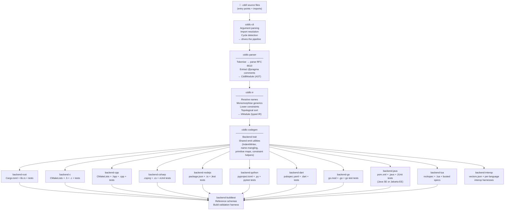

# cddlc — CDDL Compiler and Code Generator

`cddlc` parses [RFC 8610 CDDL](https://www.rfc-editor.org/rfc/rfc8610) schema files and generates
serialization/deserialization code for multiple target languages.  A single `.cddl` schema
produces a ready-to-build library — with types, encode/decode logic, and roundtrip tests — for
Rust, C, C++, C#, Node.js/TypeScript, Python, Dart, Go, Java (SE or Jakarta EE), and Lua.

## Why cddlc?

CDDL (Concise Data Definition Language) is the schema language for CBOR-based protocols
(CoAP, COSE, CWT, and others).  Writing serialization boilerplate by hand across ten languages
is error-prone and hard to keep in sync.  `cddlc` turns the authoritative schema into the
implementation: change the schema, regenerate, done.

---

## Architecture

The tool is a Rust workspace of independent crates organised as a classic compiler pipeline.



### Crate responsibilities

Every crate is in this repository under `crates/`. Until 1.1.0 each was a submodule in its own repository; those repositories keep their history but are no longer developed.

| Crate | Role |
|---|---|
| [`cddlc-parser`](crates/cddlc-parser) | RFC 8610 grammar → AST; pragma extraction |
| [`cddlc-ir`](crates/cddlc-ir) | Name resolution, generic monomorphisation, constraint lowering, topo-sort → typed IR |
| [`cddlc-codegen`](crates/cddlc-codegen) | `Backend` trait + shared emit utilities used by all backends |
| [`cddlc-cli`](crates/cddlc-cli) | CLI argument parsing, `@import` resolution with cycle detection |
| [`backend-rust`](crates/backend-rust) | Rust + minicbor / ciborium (with `#![no_std]` support) |
| [`backend-c`](crates/backend-c) | ANSI C + nanocbor / tinycbor / zcbor |
| [`backend-cpp`](crates/backend-cpp) | C++17 + nanocbor (wraps the C runtime) |
| [`backend-csharp`](crates/backend-csharp) | C# / .NET 8 + `System.Formats.Cbor` |
| [`backend-nodejs`](crates/backend-nodejs) | TypeScript 5 ESM + cborg (CBOR) or `node:buffer` (JSON) |
| [`backend-python`](crates/backend-python) | Python 3 dataclasses + cbor2 / json |
| [`backend-dart`](crates/backend-dart) | Dart 3 / Flutter + cbor ^6 (CBOR) or `dart:convert` (JSON) |
| [`backend-go`](crates/backend-go) | Go 1.21+ + fxamacker/cbor (CBOR) or `encoding/json` (JSON) |
| [`backend-java`](crates/backend-java) | Java 17 records + Jackson; Jakarta EE adds Bean Validation, and JSON-P / JSON-B for JSON |
| [`backend-lua`](crates/backend-lua) | Lua 5.3+ with an embedded pure-Lua CBOR / JSON codec (no dependencies) |
| [`backend-interop`](crates/backend-interop) | Canonical CBOR test vectors + per-language decode/roundtrip harnesses |
| [`backend-buildtest`](crates/backend-buildtest) | Reference schemas; build validation tests (invoke real toolchains) |

---

## Quick Start

### Build from source

```bash
git clone https://github.com/dgtlrift/cddlc
cd cddlc
cargo build --release
# binary at: ./target/release/cddlc
```

### Generate a Rust library

```bash
cddlc generate my_schema.cddl --lang rust --output generated/
```

### Generate for other languages

```bash
cddlc generate my_schema.cddl --lang c        --output generated/
cddlc generate my_schema.cddl --lang cpp      --output generated/
cddlc generate my_schema.cddl --lang csharp   --output generated/
cddlc generate my_schema.cddl --lang nodejs   --output generated/
cddlc generate my_schema.cddl --lang python   --output generated/
cddlc generate my_schema.cddl --lang dart     --output generated/
cddlc generate my_schema.cddl --lang go       --output generated/
cddlc generate my_schema.cddl --lang java     --output generated/
cddlc generate my_schema.cddl --lang java --java-flavor ee --output generated/   # Jakarta EE
cddlc generate my_schema.cddl --lang lua      --output generated/
```

### JSON instead of CBOR

```bash
cddlc generate my_schema.cddl --lang python --format json --output generated/
```

### Validate JSON or CBOR data against a schema

```bash
cddlc validate --cddl my_schema.cddl --json instance.json
cddlc validate --cddl my_schema.cddl --cbor instance.cbor
cddlc validate --cddl my_schema.cddl --type sensor-reading --json a.json --json b.json
```

CBOR is read strictly (RFC 8949): `undefined` is not `null`, a float has the width it was
encoded at (`float16`, `float32` and `float64` each require theirs), and a map with a duplicate key
or bytes after the data item doesn't decode. Prints `OK`/`FAIL` per input file, with per-field diagnostics on failure
(`readings[3].value: expected float32, found text`), and exits non-zero if
any file fails to validate. `--type` selects which schema rule to validate
against; it defaults to the schema's root type (the first rule declared in
the file, per RFC 8610). See [Known Gaps](#known-gaps-and-future-enhancements)
for current validator limitations.

### Print an example value

```bash
cddlc sample --cddl my_schema.cddl --type sensor-reading                 # JSON
cddlc sample --cddl my_schema.cddl --type sensor-reading --format diag   # CBOR diagnostic notation
cddlc sample --cddl my_schema.cddl --format cbor -o reading.cbor         # binary CBOR
```

```json
{
  "id": 1,
  "kind": "temp",
  "note": "text",
  "key": "AAA"
}
```

The example uses the schema's literals and `.default`s, and the smallest size or count and the
value nearest zero that its constraints allow. It includes optional members (`--minimal` leaves
them out), and a recursive type ends at a few levels. The example is checked with `validate` before
it is written: one that doesn't validate (a `.regexp` cddlc can't satisfy) is still written, with a
warning listing why, and a non-zero exit.

---

## CLI Reference

`cddlc` has three subcommands: `generate` (compile a schema to target-language
code), `validate` (check JSON/CBOR data against a schema) and `sample` (print an
example value of a schema type).

```
cddlc <COMMAND>

Commands:
  generate    Generate serialization/deserialization code for a target language
  validate    Validate JSON/CBOR documents against a CDDL schema
  sample      Print an example value of a schema type, as JSON, CBOR or diagnostic notation
```

### `cddlc generate`

```
cddlc generate [OPTIONS] <INPUT>...

Arguments:
  <INPUT>...    One or more .cddl source files (entry points)

Options:
  -l, --lang <LANG>               Target language [default: rust]
                                  [values: rust, c, cpp, csharp, nodejs, python, dart, go, java, lua]
  -o, --output <DIR>              Output directory [default: ./generated]
      --format <FMT>              Serialization format [default: cbor]
                                  [values: cbor, json]
  -r, --runtime <NAME>            CBOR runtime library [default: minicbor]
                                  rust:  minicbor | ciborium | cbor4ii
                                  c/cpp: tinycbor | nanocbor | zcbor
      --alloc <STRATEGY>          Allocation strategy [default: arena]
                                  [values: stack, arena, heap]
      --no-std                    Rust only: emit #![no_std] + heapless collections
      --dcbor                     Emit deterministic (dCBOR, RFC 8949 §4.2) encoding
      --java-flavor <FLAVOR>      Java: se, or ee for Jakarta EE [default: se]
      --depth-limit <N>           Max decoder nesting depth [default: 16]
      --max-array <N>             Capacity for unbounded sequences [* T] [default: 16]
      --max-str <N>               Capacity for unbounded strings [default: 64]
      --namespace <NS>            Namespace/module prefix for emitted symbols
      --include-dir <DIR>         Additional search path for @import (repeatable)
      --interop                   Generate cross-language interop test vectors
      --interop-langs <LIST>      Comma-separated list of interop harness languages
                                  [default: rust,c,cpp,csharp,nodejs,python,go,java,lua]
      --dry-run                   Parse and analyse only; do not write files
      --no-source-comments        Leave each item's CDDL source line out of its docs
      --debug-parse               Print rich parse diagnostics (also: CDDLC_TRACE=1)
  -v, --verbose                   Print resolved types, warnings, file paths
```

### `cddlc validate`

```
cddlc validate [OPTIONS] --cddl <FILE>

Options:
      --cddl <FILE>          CDDL schema entry point
      --type <NAME>          Type to validate against [default: schema's root rule]
      --json <FILE>          JSON document to validate (repeatable)
      --cbor <FILE>          CBOR document to validate (repeatable)
      --include-dir <DIR>    Additional search path for @import (repeatable)
      --debug-parse          Print rich parse diagnostics (also: CDDLC_TRACE=1)
  -v, --verbose               Verbose output
```

### `cddlc sample`

```
cddlc sample [OPTIONS] --cddl <FILE>

Options:
      --cddl <FILE>          CDDL schema entry point
      --type <NAME>          Type to give an example of [default: schema's root rule]
      --format <FORMAT>      json, cbor (binary) or diag (CBOR diagnostic notation) [default: json]
  -o, --output <FILE>        Write to FILE instead of standard output
      --minimal              Leave out optional members; repeated ones get their minimum count
      --include-dir <DIR>    Additional search path for @import (repeatable)
      --debug-parse          Print rich parse diagnostics (also: CDDLC_TRACE=1)
  -v, --verbose              Verbose output
```

---

## Comments, sources and headers

**Comments document the code** (dgtlrift/cddlc#8). A CDDL comment becomes a doc comment in every backend, in its own style (`///`, `/** */`, `/* */`, `#`, C#'s `<summary>`):
- **The lines directly above a rule** document its type, and **the lines directly above a member** document its field.
- **A comment on the line a rule or member ends on** documents it too.
- **A blank line cuts a comment off,** so file headers and section dividers document nothing.
- **`@doc "text"`** works above a rule or a member, and above a rule it replaces the comments.

```cddl
; A reading from one sensor.
reading = {
  id: uint,          ; the sensor's id
  ; The value, in degrees Celsius.
  celsius: float64,
}
```

**Each item names its source** (dgtlrift/cddlc#9). Every type and field's documentation ends with `cddl: <file>:<line>: <text>`: the CDDL line it was generated from, the path relative to where `cddlc` runs. `--no-source-comments` leaves it out.

**Each file names its cddlc and its source** (dgtlrift/cddlc#10). Every generated file (sources, headers, tests, build manifests and project files) opens with a header in that file's comment syntax:

```
// @generated by cddlc — do not edit manually
// cddlc v1.2.0 (<commit>[-dirty])
// branch <branch>, <remote>
// source <input> (sha256 <hash>, <size> bytes)
//
// <the schema's boilerplate>
```

- **One `source` line per input file,** with its path as given on the command line, and the SHA-256 and size of its contents.
- **The release** is the tag of the commit cddlc was built from, else `v` and the crate version. The commit, branch and remote come from the checkout it was built in: `unknown` outside one, or set with `CDDLC_BUILD_RELEASE`, `_COMMIT`, `_BRANCH` and `_REMOTE`. `cddlc --version` prints the same.
- **No timestamp,** so the output depends only on the inputs and the cddlc.

**The schema's boilerplate is carried over.** The comment block at the top of a `.cddl` file (a copyright or license notice, say) is repeated below the header in every generated file, with the `;` replaced by the target's comment syntax:

| CDDL | C | C++, C#, Go, Java, Rust, TypeScript, Dart | Python, CMake, TOML, YAML | Lua | XML (`pom.xml`, `.csproj`) |
|---|---|---|---|---|---|
| `; Copyright (c) 2026 Acme` | ` * Copyright (c) 2026 Acme` inside `/* … */` | `// Copyright (c) 2026 Acme` | `# Copyright (c) 2026 Acme` | `-- Copyright (c) 2026 Acme` | `  Copyright (c) 2026 Acme` inside `<!-- … -->` |

- **The block ends at the first blank line.** A comment block a rule follows directly is that rule's documentation, not boilerplate.
- **Annotation lines** (`; @import`, `; @doc`) are left out, and so are lines of only `;` (banners).
- **Text that would end the comment early** is broken up: `*/` becomes `* /` in C, and `--` becomes `- -` in XML.
- **With several inputs,** each input's block is included once.
- **JSON has no comments.** `package.json` and the interop `vectors.json` carry the header as an array in a `"//"` member, which npm and the harnesses ignore. `tsconfig.json` is read as JSON with comments, so it gets `//` lines.

## Pragma Reference

Pragmas are structured comments that influence code generation.  They appear on the line
immediately before the rule they annotate.

```cddl
; @capacity 32
; @doc "A list of recent sensor readings"
readings = [* sensor-reading]
```

| Pragma | Value | Description |
|---|---|---|
| `@import "path"` | Quoted path | Include another `.cddl` file (relative to the importing file, or `--include-dir`) |
| `@capacity N` | Integer | Maximum element count for `[* T]` / `[+ T]` arrays (overrides `--max-array`) |
| `@str-capacity N` | Integer | Maximum character count for unbounded `tstr` (overrides `--max-str`) |
| `@doc "text"` | String | Documentation comment attached to the generated type, or field (see above) |
| `@deprecated` | — | Emits a deprecation annotation on the generated type |
| `@default value` | Literal | Default value for a field |
| `@regex-hook name` | Identifier | C/Rust function name to call for `.regexp` constraint validation |
| `@skip-validation` | — | Suppress constraint checks for a field |
| `@opaque` | — | Treat the type as raw bytes (pass-through, no decode) |

---

## Supported CDDL Constructs

| Feature | Syntax | Notes |
|---|---|---|
| Primitives | `bool`, `uint`, `int`, `float32`, `float64`, `tstr`, `bstr`, `any` | `float16` maps to `float32`/`double` |
| Named structs | `foo = { field: type, ? opt: type }` | Optional fields, integer map keys |
| Type choices (enums) | `status = "ok" / "warn" / "error"`, `shape = circle / square` | String, integer, mixed or map variants; a map value decodes to the variant whose members it has |
| Group choices | `event = { type: "start" // type: "stop", code: int }` | A choice between one map (or array) per alternative |
| Enumerations | `color = &colors`, `{ state: &( on: "on", off: "off" ) }` | The choice of a group's member values (`1 / 2 / 3`) |
| Arrays | `readings = [* float32]`, `[+ T]`, `[n*m T]` | Capacity from pragma or `--max-array` |
| Tables (open maps) | `props = { * tstr => any }`, `{ + uint => tstr }` | Any number of entries of the key and value types |
| Maps with other entries | `device = { id: uint, * tstr => tstr }` | Named members plus an `extra` member holding the other entries; their keys are text |

| Type aliases | `device-id = tstr .size 16` | With optional constraints |
| CBOR tags | `#6.1(uint)` | Tag verification on decode, emission on encode |
| Generics | `pair<T> = [T, T]`, `pair<A, B> = [A, B]` | Monomorphised at use sites |
| Sockets | `$value /= uint`, `$$ext //= ( ? note: tstr )` | A type socket is the choice of its `/=` types; a group socket adds its members |
| Names | `session.status`, `$value`, `@owner` | `.` and `-` separate words, `$` and `@` are dropped: `SessionStatus`, `Value`, `Owner` |
| Imports | `; @import "common.cddl"` | Transitive, cycle-detected |
| Constraints | `.size`, `.range`, `.ge`, `.le`, `.gt`, `.lt`, `.eq`, `.ne`, `.regexp`, `.cbor`, `.cborseq` | |
| Type operators | `.within`, `.and`, `.bits`, `.plus`, `.cat`, `.det`, `.feature` | `.within` / `.and` add the other type's constraints; `.plus` / `.cat` / `.det` of literals compute one; `.feature` is the type it marks; `.bits` is checked by `cddlc validate` only. `.abnf`, `.abnfb`, `.printf`, `.join` and other operators cddlc can't check warn |
| Text encodings (RFC 9741) | `tstr .b64u (bstr .size 32)`, `.b64c`, `.b64u-sloppy`, `.b64c-sloppy`, `.hex`, `.hexlc`, `.hexuc`, `.b32`, `.h32`, `.b45`, `.base10`, `.json` | Text holding bytes, an integer or JSON that must match the operand: checked by `cddlc validate`, not by generated code (each warns) |
| Embedded CBOR | `.cbor T`, `.cborseq T` | Inner `bstr` decoded as `T` |

A map has only the members its schema gives it (RFC 8610 §3.5): generated decoders reject a key
the schema doesn't define, as `cddlc validate` does. To accept other keys, say so in the schema
with `* tstr => any`.

---

## Backend Capability Matrix

| Feature | Rust | C | C++ | C# | Node.js | Python | Dart | Go | Java | Lua |
|---|:---:|:---:|:---:|:---:|:---:|:---:|:---:|:---:|:---:|:---:|
| CBOR encode/decode | ✓ | ✓ | ✓ | ✓ | ✓ | ✓ | ✓ | ✓ | ✓ | ✓ |
| JSON encode/decode | ✓ | ✓ | ✓ | ✓ | ✓ | ✓ | ✓ | ✓ | ✓ | ✓ |
| Structs | ✓ | ✓ | ✓ | ✓ | ✓ | ✓ | ✓ | ✓ | ✓ | ✓ |
| Enums (string/int/mixed) | ✓ | ✓ | ✓ | ✓ | ✓ | ✓ | ✓ | ✓ | ✓ | ✓ |
| Arrays / typed lists | ✓ | ✓ | ✓ | ✓ | ✓ | ✓ | ✓ | ✓ | ✓ | ✓ |
| Record arrays (`[a: uint, b: tstr]`) | ✓ | ✓ | ✓ | ✓ | ✓ | ✓ | ✓ | ✓ | ✓ | ✓ |
| Repeated groups in arrays (`[* (a: uint, b: tstr)]`) | ✓ | ✓ | ✓ | ✓ | ✓ | ✓ | ✓ | ✓ | ✓ | ✓ |
| Tables (`{ * tstr => V }`) | ✓ | ✓ | ✓ | ✓ | ✓ | ✓ | ✓ | ✓ | ✓ | ✓ |
| Maps with other entries (`{ id: uint, * tstr => V }`) | ✓ | ✓ | ✓ | ✓ | ✓ | ✓ | ✓ | ✓ | ✓ | ✓ |
| Type aliases | ✓ | ✓ | ✓ | ✓ | ✓ | ✓ | ✓ | ✓ | ✓ | ✓ |
| CBOR tags | ✓ | ✓ | ✓ | ✓ | ✓ | ✓ | ✓ | ✓ | ✓ | ✓ |
| Optional fields | ✓ | ✓ | ✓ | ✓ | ✓ | ✓ | ✓ | ✓ | ✓ | ✓ |
| Roundtrip tests | ✓ | ✓ | ✓ | ✓ | ✓ | ✓ | ✓ | ✓ | ✓ | ✓ |
| Inline constraint validation | ✓ | ✓ | ✓ | partial | partial | partial | — | ✓ | ✓ | ✓ |
| dCBOR deterministic encoding | ✓ | ✓ | ✓ | ✓ | ✓ | ✓ | — | ✓ | ✓ | ✓ |
| `#![no_std]` support | ✓ | N/A | N/A | N/A | N/A | N/A | N/A | N/A | N/A | N/A |
| Interop test harness | ✓ | ✓ | ✓ | ✓ | ✓ | ✓ | — | ✓ | ✓ | ✓ |

In CBOR, Rust, Python, Go, C, C++ and C# tables take integer or text keys. JSON objects
have text keys, and the TypeScript, Java and Lua value models read a map's keys as text, so
there tables need `tstr` keys.

A map with named members and other entries gets one more member, `extra` (or `extra_entries`
when a member is already called `extra`), holding the other entries: a map from text key to
value. Decoding puts every key that no named member has there; encoding writes them after the
named members. Their keys must differ from the named members' keys: the Python, TypeScript,
Go, Java, Lua and C# encoders (and C++ JSON) reject one that doesn't; the others write it
as is. In C# JSON the values are `JsonElement`s (the serializer's extension data).

---

## Interoperability Testing

`--interop` generates canonical CBOR test vectors (using the Rust encoder as the reference
implementation) plus decode/roundtrip harnesses for each target language.  This lets you confirm
that a Rust encoder and a Python decoder agree on the wire format.

```bash
cddlc generate my_schema.cddl --interop --interop-langs rust,python -o generated/
```

Output layout:

```
generated/
  my_schema-cbor/          ← the generated library
  my_schema-interop/
    vectors.json           ← human-readable test vectors
    vectors.cbor           ← binary CBOR version of the vectors
    rust/interop_test.rs
    c/test_interop.c
    cpp/test_interop.cpp
    csharp/InteropTests.cs
    nodejs/interop.test.ts
    python/test_interop.py
    go/interop_test.go
    java/InteropTest.java
    lua/interop_spec.lua
```

See [`docs/interop-testing.md`](docs/interop-testing.md) for detailed instructions per language.

---

## Running the Build Validation Tests

The `backend-buildtest` crate invokes the real language toolchains to verify that generated code
actually compiles and its tests pass.  They are marked `#[ignore]`, so a plain `cargo test` skips
them; CI's `build-tests` job runs them for every language, with `CDDLC_REQUIRE_TOOLS=1` so that a
missing toolchain fails the job rather than skipping its schemas.

```bash
# All languages (requires all toolchains installed):
cargo test -p backend-buildtest --test build_validation -- --ignored --nocapture

# Single language:
cargo test -p backend-buildtest --test build_validation test_build_rust -- --ignored --nocapture
```

`scripts/interop.sh <lang>` runs the interop vectors for every reference schema through that
language's harness, as CI does after the build tests.

To see which languages this machine can test, and how to install the rest, run
`target/debug/cddlc-toolchains` (built by `cargo build`). A language whose toolchain is missing
is skipped, and its install command is printed once. The command is for this host's package
manager: apt, dnf, zypper, pacman, apk, Homebrew or Chocolatey. Set `CDDLC_PKG_MANAGER` to pick
another. With `CDDLC_REQUIRE_TOOLS=1`, as in CI, a missing toolchain fails instead.

A build that can't reach a package registry (a rate limit such as Maven Central's 429, a
timeout, DNS) is retried `CDDLC_NETWORK_RETRIES` times (default 2). If it still can't, it's
reported as *unavailable*, and in CI as a GitHub Actions warning, not as a failure. A registry
outage therefore doesn't fail a required check on an ordinary pull request. A release PR
(release-plz's `release-plz-*` branch, or the `release` label) is different: CI sets
`CDDLC_REQUIRE_REGISTRIES`, and an unavailable schema fails it, so a release can't go out
with a language that wasn't tested. CI also caches each language's downloads between runs.

### Published schemas

`crates/cddlc-cli/tests/corpus/` holds CDDL written by others: the RFC collection that
[cabo/cddlc](https://github.com/cabo/cddlc) bundles (COSE, CWT, CoSWID, EDHOC, ...) and
WebDriver BiDi. `cargo test -p cddlc-cli --test corpus` generates each one in every language
and format. A schema cddlc can't take yet is listed with its error and the issue tracking it,
and the test fails when one starts working, so the list stays current.

---

## Known Gaps and Future Enhancements

### Missing backends

| Language | Priority | Notes |
|---|---|---|
| Kotlin | High | Very common for Android; Kotlin can use the Java backend's output today |
| Swift | High | Required for Apple ecosystem / CoreBluetooth |
| Zig | Low | Attractive for embedded / no-std targets |

### Per-backend gaps

- **Dart**: missing dCBOR deterministic encoding, constraint validation, and interop harness generation.
- **C# / Node.js / Python**: constraint validation is partial (`.size`, `.range` checks only; `.regexp` not enforced).
- **Go**: `.regexp` constraints are not checked; `float16` is written at float32 width.
- **Java**: `float16` is written at float32 width; Jakarta EE `@Size` on text counts UTF-16 chars, not UTF-8 bytes.
- **Lua**: `float16` is written at float32 width; `.regexp` constraints are not checked; Lua 5.3+ only (no LuaJIT).
- **Rust**: `ciborium` and `cbor4ii` runtime options are listed in the CLI but the backend only fully implements `minicbor`.
  A recursive type (`tree = { ? left: tree }`) holds a `Box` where it would contain itself, so with `--no-std`
  such a schema needs `alloc`. The runtime's own types live in modules of their own,
  `cddlc_runtime` (`ErrorCode`, `FieldError`) and `cddlc_bits` (`BitsCheck`). They're
  re-exported at the crate root unless a rule takes the name, as WebDriver BiDi's
  `ErrorCode` does.
- **C / C++**: recursive types don't compile yet (#156).

### Schema language gaps

- **Groups** are inlined where they are used: group references, `? group`, unwrapped maps
  and arrays (`~base`) and group sockets (`$$ext //= (...)`). A choice between groups
  (`{ a: uint // b: tstr }`, or a group `g = (a // b)` used in one) is a choice between maps
  or arrays, one per alternative, up to 256 of them. Alternatives that differ by a text literal
  under one key (`method: "browser.close"` / `method: "session.end"`) are named after it
  (`<rule>-browser.close`); others are numbered (`<rule>-alt1`, ...). A repeated group in a
  map (`{ * g }`), and a socket extended by more than one `//=` with choices, are rejected as
  unsupported; several `//=` extensions of one socket add members rather than alternatives.
- **A repeated group in an array** (`[* (a: uint, b: tstr)]`, or `[+ pair]` for a group rule
  `pair`) is a list of `<rule>-entry` records whose members sit inline: `[1, "x", 2, "y"]` holds
  two. Each repetition must have the same members, so a group with optional or repeated
  members, or with choices, is rejected as unsupported, as is a repeated group among other
  array members (`[id: uint, * (a: uint, b: tstr)]`).
- **Occurrence in struct fields beyond `?`** (e.g. `* field: T`) is not modelled as repeated struct fields.
- **Maps with named members and other entries** need text keys for the other entries
  (`{ a: uint, * tstr => any }`); other key types there (`{ 1 => int, * int => any }`), and
  more than one member with a computed key, are rejected with an "unsupported" error.

### Validator gaps (`cddlc validate`)

- **Tagged prelude types** (`tdate`, `time`, `uri`, `b64url`, `biguint`, `bigint`,
  `encoded-cbor`, `regexp`, `mime-message`, `cbor-any`, ...) validate permissively
  (any value passes) rather than against their RFC 8949 §6.1 JSON mapping — `cddlc-ir`
  collapses these prelude names to `Primitive::Any` during lowering, before the name
  reaches the validator. Explicit tags written directly in a schema (`#6.0(tstr)`) are
  unaffected. See `crates/cddlc-validate/src/lib.rs` for detail.
- No **CSV** validation (JSON and CBOR only).

### Tooling gaps

- No **watch mode** — regeneration requires re-running the CLI manually.
- No **schema diff / migration** tooling to detect breaking changes between schema versions.
- No **JSON Schema** or **Protobuf** import — `cddlc` is CDDL-only.
- The `--dry-run` flag reports type counts but does not emit a machine-readable IR dump.
- The interop test harness does not include Dart.
- Not published on crates.io (#111); releases attach a static x86-64 Linux binary, or build from source.

---

## Project Layout

```
cddlc/
├── Cargo.toml                 Workspace manifest; the root `cddlc` package (the release)
├── CHANGELOG.md               Written by release-plz
├── release-plz.toml           Release settings
├── scripts/release.sh         Release PRs, and the release steps by hand
├── crates/
│   ├── cddlc-parser/          RFC 8610 parser
│   ├── cddlc-ir/              IR lowering
│   ├── cddlc-codegen/         Backend trait + utilities
│   ├── cddlc-cli/             CLI entry point
│   ├── backend-rust/
│   ├── backend-c/
│   ├── backend-cpp/
│   ├── backend-csharp/
│   ├── backend-nodejs/
│   ├── backend-python/
│   ├── backend-dart/
│   ├── backend-go/
│   ├── backend-java/
│   ├── backend-lua/
│   ├── backend-interop/       Cross-language interop vectors
│   └── backend-buildtest/     Build validation harness
├── docs/
│   └── interop-testing.md
└── test_all                   Shell script: run all backend smoke tests
```

## Releasing

Releases are made with [release-plz](https://release-plz.dev): a release PR bumps the workspace version and writes `CHANGELOG.md` from the conventional commit messages (`feat(scope): …`, `fix(scope): …`), and merging it tags `v<version>` and makes the GitHub release, with a static x86-64 Linux binary attached. Nothing is published to crates.io. Release PRs are opened with `scripts/release.sh pr` (with release-plz, rustup and gh installed). When one is merged, `.github/workflows/release-plz.yml` makes the release and attaches the binary; `release` and `binary` do the same by hand. The workflow never opens pull requests, as that needs the repository setting that lets Actions create and approve them, which stays off.

```bash
export GIT_TOKEN="$(gh auth token)"
scripts/release.sh pr        # the release PR; review and merge it
# The workflow then releases. Without GitHub Actions, by hand:
scripts/release.sh release   # the tag and the GitHub release
scripts/release.sh binary    # at the tag: the binary and its .sha256, attached
```

---

## License

Licensed under MIT OR Apache-2.0 at your option.
