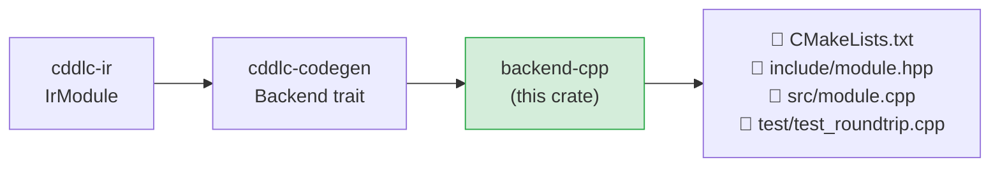

# backend-cpp

Generates a C++17 library from an `IrModule`: a CMake project with a header, an
implementation file and a roundtrip test. CBOR output wraps the
[nanocbor](https://github.com/bergzand/NanoCBOR) C runtime; JSON output uses
[nlohmann/json](https://github.com/nlohmann/json). Both are fetched by CMake.

## Position in the pipeline



## Generated output layout

```
<output>/<module>-cbor-cpp/        # --format cbor (default)
  CMakeLists.txt                   # library + test; fetches nanocbor (pinned commit)
  include/<module>.hpp             # types and encode/decode declarations
  src/<module>.cpp                 # encode/decode implementations
  compat/endian.h                  # macOS shim for nanocbor's <endian.h>
  test/test_roundtrip.cpp          # assert-based roundtrip test, run by ctest

<output>/<module>-json-cpp/        # --format json
  CMakeLists.txt                   # library + test; fetches nlohmann/json
  include/<module>.hpp
  src/<module>.cpp
  test/test_roundtrip.cpp
```

Everything is declared in `namespace <module>`.

## Example

The examples below are generated from this schema:

```cddl
; A device report.
device = {
  id:      device-id,
  active:  bool,
  status:  status,
  ? label: tstr,
}
status    = "ok" / "warn" / "error"
device-id = tstr
```

## CBOR (`--format cbor`)

### Types

```cpp
struct DeviceId {
    std::string_view value{};
    bool operator==(const DeviceId &o) const noexcept { return value == o.value; }
};

struct Status {
    /// Which variant this value is.
    enum class Kind { Ok, Warn, Error };
    using Variant = std::variant<std::monostate>;

    Kind kind{Kind::Ok};
    Variant value{};

    static Status make_Ok() { return Status{Kind::Ok, Variant{}}; }
    static Status make_Warn() { return Status{Kind::Warn, Variant{}}; }
    static Status make_Error() { return Status{Kind::Error, Variant{}}; }

    bool operator==(const Status &o) const noexcept { return kind == o.kind && value == o.value; }
};

/// A device report.
struct Device {
    DeviceId id{};
    bool active{};
    Status status{};
    std::optional<std::string_view> label{};

    bool operator==(const Device &o) const noexcept { ... }
};
```

- **Structs** are plain aggregates. Optional members are `std::optional<T>`;
  repeated members are `std::array<T, N>` (`std::vector<T>` with `--alloc heap`).
- **`tstr` and `bstr`** are `std::string_view`: zero-copy views into the buffer
  being decoded, so that buffer must outlive the decoded value.
- **Aliases** are each their own struct holding `value`, so two aliases of the
  same C++ type (`a = tstr`, `b = bstr`) still get distinct `encode`/`decode`
  overloads, each writing its own CBOR type.
- **Enums** are a struct with a `Kind kind` naming the variant and a
  `std::variant` holding the payload of valued variants. Each variant has a
  `make_<Variant>` constructor. Text, `nil` and integer-literal variants carry
  no payload, so their constructors take no argument (`Status::make_Warn()`).
  Valued variants (`uint`, `int`, `bool`, floats, `tstr`, `bstr`, named types)
  take their value: for `level = uint / "off"`, `Level::make_Uint(5)`. Decoding
  picks the variant by the CBOR type it reads, matching literals first.
- **Arrays** are a struct with `std::array<T, N> items` and `std::size_t count`;
  `N` comes from `; @capacity` or `--max-array`. With `--alloc heap` they are a
  struct with `std::vector<T> items` and no capacity limit.
- Doc comments and `; @doc` pragmas become `///` comments.

### Functions

Every type gets an `encode`/`decode` overload pair:

```cpp
int encode(nanocbor_encoder_t *enc, const Device &val);
int decode(nanocbor_value_t *dec, Device &out, const Callbacks &cb = {}, void *ctx = nullptr);
```

Both return a negative value on failure. `Callbacks` lets the caller observe
errors and unknown map keys during decode; a map with a key its schema doesn't
define is reported to `on_unknown_field`, then rejected:

```cpp
struct Callbacks {
    void (*on_error)(void *ctx, FieldError err){nullptr};          // code, field name, index
    void (*on_unknown_field)(void *ctx, std::string_view key){nullptr};
};
```

### Usage

```cpp
#include "device.hpp"

using namespace device;

Device dev{};
dev.id     = DeviceId{"sensor-7"};
dev.active = true;
dev.status = Status::make_Warn();
dev.label  = "kitchen";

uint8_t buf[128];
nanocbor_encoder_t enc;
nanocbor_encoder_init(&enc, buf, sizeof buf);
if (encode(&enc, dev) < 0) { /* buffer too small */ }
size_t len = nanocbor_encoded_len(&enc);

Device back{};
nanocbor_value_t dec;
nanocbor_decoder_init(&dec, buf, len);
if (decode(&dec, back) < 0) { /* invalid input */ }
```

## JSON (`--format json`)

Owning types (`std::string`, `std::vector<uint8_t>`) and member functions:

```cpp
struct DeviceId {
    std::string value{};
    std::vector<uint8_t> encode() const;
    static DeviceId decode(const std::vector<uint8_t>& data);
};

using Status = std::string;

struct Device {
    DeviceId id{};
    bool active{};
    Status status{};
    std::optional<std::string> label{};
    std::vector<uint8_t> encode() const;
    static Device decode(const std::vector<uint8_t>& data);
};
```

`bstr` members are base64url strings in JSON (`b64url_encode` / `b64url_decode`
are generated alongside).

## dCBOR

With `--dcbor`, struct encoders write map members sorted by name.

## Build the generated code

```bash
cd <output>/<module>-cbor-cpp
cmake -S . -B build -DCMAKE_BUILD_TYPE=Release
cmake --build build
(cd build && ctest --output-on-failure)
```

Requires CMake 3.17+ (3.16+ for JSON) and a C++17 compiler. CMake downloads
nanocbor (or nlohmann/json) on the first configure.

## Known gaps

- **nanocbor only**: `--runtime` is accepted, but only nanocbor is wired up.
- **`.regexp`** constraints need a user-supplied `@regex-hook`.

## License

MIT OR Apache-2.0
