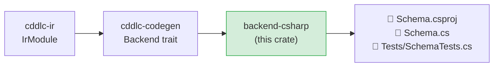

# backend-csharp

Generates a complete C# / .NET 8 library — a `.csproj`, source files, and an xUnit test
project — from an `IrModule`.  The generated code uses `System.Formats.Cbor` (inbox in
.NET 6+) for CBOR and `System.Text.Json` for JSON.

## Position in the pipeline



## Generated output layout

```
<output>/
  <Module>.csproj          # SDK-style project targeting net8.0
  <Module>.cs              # all types with encode/decode methods
  Tests/
    <Module>Tests.csproj   # xUnit test project
    <Module>Tests.cs       # roundtrip test for every type
```

## What is generated per IR type

### Structs

```csharp
public sealed class Device
{
    public string  Id     { get; set; } = string.Empty;
    public bool    Active { get; set; }
    public string? Label  { get; set; }    // optional: null when absent

    public static Device Default => new();

    public void Encode(CborWriter writer)          { … }   // --format cbor
    public static Device Decode(CborReader reader) { … }

    public byte[] ToJson()                         { … }   // --format json
    public static Device FromJson(byte[] data)     { … }
}
```

- Optional members are nullable (`string?`, `long?`). An absent one is left out of the
  map rather than written as `null`.
- A record (`[x: int, y: int]`) is a class too, encoded as an array of its members' values
  in order; in JSON a generated `JsonConverter` writes it as an array.
- A member whose type is an inline choice of different C# types (`int / float`) is an
  `object` holding one of them. Encoding writes the alternative the value holds; decoding
  tries the alternatives in order.
- Floats are written at their CDDL width (`float32` as four bytes); with `--dcbor`, in the
  shortest form that keeps the value.

### Enums

```csharp
public abstract class Status
{
    public sealed class Ok : Status { public static readonly Ok Instance = new(); … }
    …
    public static Status Decode(CborReader reader) { … }
}
```

A variant that is a literal (`"ok"`, `1`, `nil`) is a singleton that writes its literal;
any other variant holds a value of its type. Decoding returns the first variant, in the
CDDL's order, that the item matches.

### Arrays

```csharp
public List<float> Items { get; set; } = new();
// encoded as a definite-length CBOR array
```

### Aliases

```csharp
// Transparent alias — generated as a using directive or documented typedef
```

## Supported serialization formats

| `--format` | Generated code |
|---|---|
| `cbor` | `System.Formats.Cbor.CborWriter` / `CborReader` |
| `json` | `System.Text.Json.JsonSerializer` |

## dCBOR support

When `--dcbor` is passed, CBOR map writes sort keys before encoding, producing
deterministic output compatible with COSE and similar protocols.

## Build and test

```bash
cd <output>/
dotnet build
dotnet test Tests/
```

Requires .NET 8 SDK or later.

## Known gaps and future enhancements

- **Partial constraint validation**: `.size` and numeric range constraints emit
  `ArgumentException` guards; `.regexp` constraints reach the IR but are not emitted in
  the generated code.
- **No XML doc comments**: `@doc` pragma text is not rendered as `/// <summary>` lines.
- **No NuGet packaging**: no `.nuspec` or `PackageReference` publish configuration.
- **`System.Formats.Cbor` requirement**: requires .NET 6+; no fallback for .NET Framework
  or older .NET Core targets.
- **Mutable properties**: all properties use `{ get; set; }`; a `--immutable` option for
  `init`-only / `required` members would be more idiomatic for C# 11+.
- **No source generators**: encode/decode is explicit method bodies; a Roslyn source
  generator approach would allow incremental SDK-integrated regeneration.

## License

MIT OR Apache-2.0
