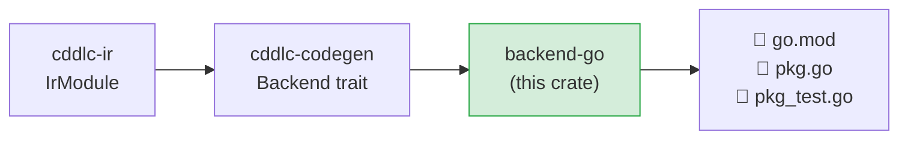

# backend-go

Generates a Go module — `go.mod`, a package source file, and `go test` tests —
from an `IrModule`. The generated code uses
[fxamacker/cbor](https://github.com/fxamacker/cbor) for CBOR and the standard
library's `encoding/json` for JSON.

## Position in the pipeline



## Generated output layout

```
<output>/<module>-cbor/
  go.mod          # module <module>-cbor; requires github.com/fxamacker/cbor/v2 (CBOR only)
  <pkg>.go        # every type, with its marshal/unmarshal methods
  <pkg>_test.go   # roundtrip tests for every type
```

The package name is the module name in lowercase letters and digits
(`iot_sensor` → `iotsensor`), or `--namespace` when given.

```bash
cd <output>/<module>-cbor
go mod tidy     # fetches fxamacker/cbor and writes go.sum
go test ./...
```

## Runtime

| Format | Runtime library |
|---|---|
| CBOR (default) | [fxamacker/cbor/v2](https://github.com/fxamacker/cbor) v2.9.0 (Go 1.20+) |
| JSON | `encoding/json`; `bstr` values are base64url text without padding |

Requires Go 1.21+.

## What is generated per IR type

Every type implements the format's marshaler interfaces — `MarshalCBOR` /
`UnmarshalCBOR`, or `MarshalJSON` / `UnmarshalJSON` — so it nests inside other
Go types and works with `cbor.Marshal` / `json.Marshal` directly. Each also has
`Encode() ([]byte, error)` and a `Decode<Type>(data []byte)` function, and
structs and aliases have `Validate() error`.

- Maps are written in schema order, not Go's map order, so the bytes match the
  other backends and the interop vectors.
- Decoding checks every value's CBOR/JSON type and every CDDL constraint, and
  each error names the type and member (`Holder.temp: value must be >= -40 and
  <= 85`). Encoding checks constraints too.

### Structs

```go
type Reading struct {
	SensorId uint64
	Value    float32
	Unit     *string // optional: nil leaves it out of the map
}
```

A member whose Go name would clash with a generated method (`encode`,
`validate`) gets a trailing underscore (`Encode_`).

### Enums

```go
type Level struct {
	Kind LevelKind // LevelKindUint or LevelKindOff
	Uint uint64    // the value of the Uint variant
}

func NewLevelUint(x uint64) Level
func NewLevelOff() Level
```

`Kind` names the variant; a valued variant's value is in the field named after
it. Text, `nil` and integer-literal variants carry no value. Decoding picks the
variant from the value's type, matching literals first.

### Recursive types

A required member or variant that holds its own type again by value is a
pointer, since a Go type can't contain itself:

```go
type Binop struct {
	Op  string
	Lhs *Expr // expr = int / binop; binop = [op: tstr, lhs: expr, rhs: expr]
	Rhs *Expr
}
```

An optional member is a pointer already, and a slice or map holds its values
elsewhere, so neither adds one. `Validate` (and so encoding) fails on a nil
required pointer, decoding allocates the value, and `NewExprBinop(x)` takes the
value and stores its address.

### `any`

A member of type `any` is any data item (dgtlrift/cddlc#178): a `RawItem`, an
alias of `cbor.RawMessage` (`json.RawMessage` in JSON) holding the item's
encoding. Decoding keeps a copy of the item's bytes, encoding writes them back
unchanged, and `cbor.Unmarshal` (or `json.Unmarshal`) decodes them further.
An empty `RawItem` is `null`. A choice's `any` variant takes any item the
others don't.

### Arrays and aliases

```go
type Readings []float32 // [* float32]
type DeviceId string    // tstr .size 16, checked by Validate
type Timestamp uint64   // #6.1(uint): the tag is written and checked
```

### Tags, floats, nil

- A tag on a type or member (`#6.1(uint)`) is written on encode and checked on
  decode. JSON has no tags, so they are dropped there.
- `float32` and `float16` are Go `float32` and are written as CBOR float32;
  `float64` is written as float64.
- `nil` is the generated `Null` type (`struct{}`); an optional `nil` member is
  `*Null`, set when the member is present.

## Known gaps

- **`float16`** is written at float32 width.
- **`.regexp`** constraints are not checked.
- **JSON `bstr` / `tstr` choices**: in JSON a byte string is text, so an enum
  with both a `bstr` and a `tstr` variant decodes such text as the `tstr` one.

## License

MIT OR Apache-2.0
