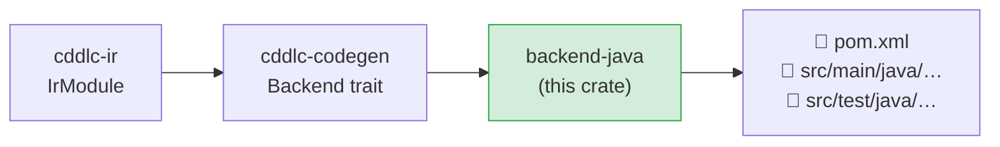

# backend-java

Generates a Maven project — `pom.xml`, Java 17 sources and JUnit tests — from
an `IrModule`, for **Java SE** or **Jakarta EE** (`--java-flavor ee`). The
generated code uses [Jackson](https://github.com/FasterXML/jackson-dataformats-binary)
for CBOR, and Jackson (SE) or Jakarta JSON-P (EE) for JSON.

## Position in the pipeline



## Generated output layout

```
<output>/<module>-cbor/
  pom.xml
  src/main/java/<package>/
    Cddl.java            # value model, type checks and the codec
    <Type>.java          # one file per CDDL type
  src/test/java/<package>/
    RoundtripTest.java   # JUnit roundtrip tests for every type
```

The package is the module name as a Java identifier (`simple-values` →
`simple_values`), or `--namespace` when given (`--namespace com.example.iot`).

```bash
cddlc generate schema.cddl -l java                    -o generated/   # Java SE, CBOR
cddlc generate schema.cddl -l java --java-flavor ee   -o generated/   # Jakarta EE, CBOR
cddlc generate schema.cddl -l java --format json      -o generated/   # Java SE, JSON
cd generated/<module>-cbor && mvn test
```

## Runtime

| Flavor | CBOR | JSON | Also |
|---|---|---|---|
| Java SE | `jackson-dataformat-cbor` 2.22.4 | `jackson-core` 2.22.4 | — |
| Jakarta EE | `jackson-dataformat-cbor` 2.22.4 | Jakarta JSON-P 2.1 | Jakarta Bean Validation 3.1 and JSON-B 3.0 annotations |

Requires Java 17+. The Jakarta APIs are `provided` dependencies (the application
server supplies them); the tests use Hibernate Validator, Expressly, Yasson and
Parsson.

## What is generated per IR type

Every type has `encode()` / `static decode(byte[])` for the selected format,
`toRaw()` / `static fromRaw(Object)` to and from a format-neutral value, and
(structs, arrays, aliases) `validate()`. Decoding checks every value's
CBOR/JSON type and every CDDL constraint, and throws
`IllegalArgumentException` naming the type and member
(`Holder.temp: value must be >= -40 and <= 85`); encoding checks constraints
too.

### Structs: records

```java
public record Reading(long sensorId, float value, String unit) { … }
```

- Optional members are nullable boxed types (`String unit`, `Long count`); an
  absent one is left out of the map. Members are written in schema order.
- Members whose names clash with Java keywords or generated methods get a
  trailing underscore (`class_`, `encode_`).
- Records holding byte strings compare them by content.

### Enums

All-literal enums are Java `enum`s; `kind()` names the variant:

```java
public enum Status { OK, WARN }          // status = "ok" / "warn"
```

Enums with valued variants are sealed interfaces with a record per variant:

```java
public sealed interface Level {          // level = uint / "off"
    record Uint(long value) implements Level { … }
    record Off() implements Level { … }
}
```

Decoding picks the variant from the value's type, matching literals first.

### Arrays and aliases

```java
public record Readings(List<Float> items) { … }   // readings = [* float32]
public record DeviceId(String value) { … }       // device-id = tstr .size 16
public record Timestamp(long value) { … }        // timestamp = #6.1(uint)
```

### Values

| CDDL | Java |
|---|---|
| `uint` | `long`, unsigned: values above `Long.MAX_VALUE` are stored as their bit pattern (`Long.toUnsignedString`) and compared with `Long.compareUnsigned` |
| `int` | `long` |
| `float16`, `float32` | `float`, written as CBOR float32 |
| `float64` | `double` |
| `tstr` / `bstr` | `String` / `byte[]` (JSON: base64url text without padding) |
| `nil` | `Cddl.Null.NULL` |
| `#6.N(T)` | `T`, the tag written and checked (JSON has no tags) |

## Jakarta EE

`--java-flavor ee` adds, on top of the same types and checks:

- **Bean Validation** annotations on record components, so `@Valid` in JAX-RS,
  JPA or CDI checks the CDDL constraints: `@NotNull` on required references,
  `@Size` for `.size`, `@Min` / `@Max` (and `@DecimalMin` / `@DecimalMax`) for
  ranges, `@AssertTrue` / `@AssertFalse` for `true` / `false` members, `@Pattern`
  for text literals and `.regexp`, and `@Valid` to cascade into nested types.
  `validate()` stays, so encoding and decoding don't depend on a validator.
- **JSON-B** (JSON only): each type names a serializer and deserializer
  (an adapter for Java `enum`s), so `JsonbBuilder.create().toJson(x)` writes the
  same JSON as `x.encode()`, and JAX-RS endpoints using JSON-B read and write
  the CDDL wire format. JSON is read and written with JSON-P.

The generated EE tests check every value with Bean Validation and, for JSON,
that JSON-B writes and reads the same JSON.

## Known gaps

- **`float16`** is written at float32 width.
- **`@Size` on text** counts UTF-16 chars, while CDDL `.size` (and
  `validate()`) counts UTF-8 bytes; they differ for non-ASCII text.
- **JSON `bstr` / `tstr` choices**: in JSON a byte string is text, so an enum
  with both a `bstr` and a `tstr` variant decodes such text as the `tstr` one.
- **Numeric bounds past `i64::MAX`** are mis-lowered by the IR (#72).

## License

MIT OR Apache-2.0
