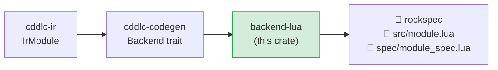

# backend-lua

Generates a LuaRocks package — a rockspec, one Lua module and
[busted](https://lunarmodules.github.io/busted/) specs — from an `IrModule`. The
module carries its own pure-Lua CBOR or JSON codec, so it has **no runtime
dependencies**. Requires Lua 5.3, 5.4 or 5.5.

## Position in the pipeline



## Generated output layout

```
<output>/<module>-cbor/
  <module>-cbor-0.1.0-1.rockspec   # depends on lua >= 5.3; tests with busted
  src/<module>.lua                 # every type, plus the CBOR (or JSON) codec
  spec/<module>_spec.lua           # busted roundtrip specs
```

The module name is the CDDL module name as a Lua identifier (`simple-values` →
`simple_values`), or `--namespace` when given (`acme.iot` → `src/acme/iot.lua`).

```bash
cddlc generate schema.cddl -l lua -o generated/
cd generated/<module>-cbor
busted                 # or: luarocks make && luarocks test
```

## Usage

```lua
local iot = require("iot_sensor")

local reading = iot.SensorReading.new({
  sensor_type = iot.SensorType.Temperature(),
  value = 21.5,
})
local bytes = reading:encode()                     -- or iot.SensorReading.encode(reading)
local back = iot.SensorReading.decode(bytes)       -- raises an error on invalid input

local id = iot.DeviceId.decode(iot.DeviceId.encode("0123456789abcdef"))
```

Every type `T` has `T.validate(v)`, `T.encode(v)`, `T.decode(data)`, and
`T.to_raw(v)` / `T.from_raw(item)` to and from the codec's item model. Errors
are raised with `error()` and name the type and member
(`Holder.temp: value must be >= -40 and <= 85`).

| CDDL | Lua |
|---|---|
| map (struct) | a table with the type as metatable: `T.new({ member = ... })`; members are snake_case, optional ones `nil` when absent |
| enum | `{ kind = "Name", value = ... }`, made by `T.Name(value)` or `T.Name()` |
| array | a sequence with the type as metatable: `T.new({ ... })` |
| table (`{ * tstr => V }`) | a table from key to value with the type as metatable: `T.new({ [key] = value })`; keys are text, written in sorted order |
| alias | the plain Lua value: `T.encode("...")` |
| `uint` / `int` | integers; a uint above 2^63 is its 64-bit pattern (a negative integer), compared with `math.ult` |
| `float16`, `float32` / `float64` | numbers, written as CBOR float32 / float64 |
| `tstr` / `bstr` | strings (`#` counts bytes, as CDDL's `.size` does); JSON bytes are base64url |
| `nil` | `M.null` (Lua's `nil` can't be stored in a table) |
| `#6.N(T)` | `T`; the tag is written and checked (JSON has no tags) |

- Members are written in schema order, with definite lengths, so the bytes
  match the other backends.
- Decoding checks every item's kind and every CDDL constraint; encoding checks
  the Lua values' types and the constraints.
- Members whose names are Lua keywords or the type's functions get a trailing
  underscore (`end_`, `encode_`).

## `any`

A member of type `any` is any data item (dgtlrift/cddlc#178): the runtime's
item for it, a table naming its kind (`{ k = "array", v = { ... } }`,
`{ k = "map", v = { { key, item }, ... } }`, `{ k = "uint", v = 1 }`, ...),
which encoding writes back byte for byte: a float keeps its width, a map its
keys and their order, and `undefined` and tags stay as they were. A choice's
`any` variant takes any item the others don't.

## Known gaps

- **`float16`** is written at float32 width.
- **`.regexp`** constraints are not checked (Lua patterns are not regular
  expressions).
- **JSON `bstr` / `tstr` choices**: in JSON a byte string is text, so an enum
  with both a `bstr` and a `tstr` variant decodes such text as the `tstr` one.
- **LuaJIT / Lua 5.1** are not supported: the code needs 5.3's integer subtype,
  bitwise operators, `string.pack` and `utf8`.

## License

MIT OR Apache-2.0
