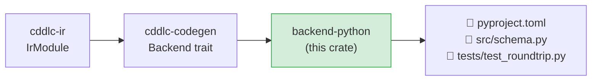

# backend-python

Generates a complete Python 3 library — `pyproject.toml`, a source module, and a pytest
test suite — from an `IrModule`.  The generated code uses Python dataclasses for types,
[cbor2](https://pypi.org/project/cbor2/) for CBOR, and the built-in `json` module for JSON.

## Position in the pipeline



## Generated output layout

```
<output>/
  pyproject.toml           # PEP 517 build config; deps: cbor2>=6.0; dev: pytest
  src/
    <module>.py            # all types as @dataclass with encode/decode methods
  tests/
    test_roundtrip.py      # pytest roundtrip tests for every type
```

## Runtime

| Format | Runtime library |
|---|---|
| CBOR (default) | [cbor2](https://pypi.org/project/cbor2/) 6.0 or later (for `semantic_decoders`) |
| JSON | Built-in `json` module; `bstr` values are base64url strings |

Requires Python 3.11+.

## What is generated per IR type

Every class has `encode() -> bytes` and `decode(data: bytes)` for the selected
format. Under them, `_to_raw()` and `_from_raw(raw)` convert to and from plain
Python values, so nested types, tags and JSON's base64url bytes are handled in
one place. `decode` checks every value's type and raises `ValueError` on a
mismatch, a missing field, or a failed constraint.

### Structs

```python
@dataclass(kw_only=True)
class Device:
    id: DeviceId
    label: Optional[str] = None    # optional field
    temp: float

    def encode(self) -> bytes: …
    @classmethod
    def decode(cls, data: bytes) -> "Device": …
```

- Fields are keyword-only, so optional fields can come before required ones.
- An optional field is `Optional[T] = None` and is left out of the map when `None`.

### Enums

```python
@dataclass
class Level:
    kind: Literal["Uint", "Off"]
    value: int | None = None

    @classmethod
    def make_Uint(cls, value: int) -> "Level": …
    @classmethod
    def make_Off(cls) -> "Level": …
```

Text, `nil` and integer-literal variants carry no value. Decoding picks the
variant from the CBOR/JSON type it reads, matching literals first.

### Arrays and aliases

```python
@dataclass
class Readings:
    items: list[float] = field(default_factory=list)

@dataclass
class DeviceId:
    value: str          # tstr .size 16, checked in __post_init__
```

### Tags and floats

- `#6.N(T)` is written as `cbor2.CBORTag(N, …)` and checked on decode. Every
  tag the module uses is decoded raw, so cbor2 does not turn tag 1 into a
  `datetime`. JSON has no tags, so they are dropped.
- `float16` and `float32` values are written at their own CBOR width; cbor2
  would otherwise write every Python float as a float64.

## Install and test generated code

```bash
cd <output>/
pip install -e ".[dev]"
pytest tests/
```

The generated tests build each type, encode and decode it, and assert
`decoded == original`.

## Known gaps and future enhancements

- **`.regexp`** constraints are checked only through a user-supplied `@regex-hook`.
- **No `__slots__`**: `@dataclass` classes do not set `__slots__`.
- **No `@doc` as docstrings**: doc pragmas are not rendered as `"""…"""` docstrings.
- **No packaging for PyPI**: the `pyproject.toml` has no classifiers or publishing setup.

## License

MIT OR Apache-2.0
